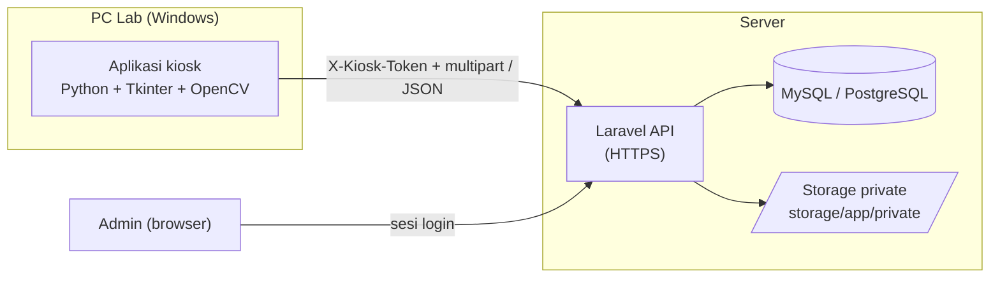

# Library PC Access & Accountability System

🌐 [English](README.md) · **Bahasa Indonesia**

Sistem kiosk *self-service* untuk lab komputer perpustakaan. Pengunjung mengisi identitas, lolos uji hardware singkat, dan difoto sebelum PC terbuka. Jika keyboard rusak atau mouse hilang, petugas dapat melihat **siapa pengguna terakhir PC tersebut, kapan, dan wajahnya**, tanpa perlu staf yang berjaga di ruangan.

- **Client (kiosk):** aplikasi Python + Tkinter di setiap PC lab (Windows), dikemas menjadi satu file `.exe`.
- **Backend:** REST API Laravel + MySQL/PostgreSQL. PC tidak pernah mengakses database secara langsung.
- **Dashboard admin:** belum dibuat (API, database, dan route foto yang dilindungi login sudah siap dipakai).

---

## Daftar Isi
1. [Cara Kerja](#1-cara-kerja)
2. [Arsitektur](#2-arsitektur)
3. [Struktur Proyek](#3-struktur-proyek)
4. [Skema Database](#4-skema-database)
5. [Referensi API](#5-referensi-api)
6. [Setup Backend (Laravel)](#6-setup-backend-laravel)
7. [Setup Client Kiosk (Python)](#7-setup-client-kiosk-python)
8. [Build File .exe](#8-build-file-exe)
9. [Deploy ke PC Lab](#9-deploy-ke-pc-lab)
10. [Referensi Konfigurasi](#10-referensi-konfigurasi)
11. [Model Keamanan dan Keterbatasan](#11-model-keamanan-dan-keterbatasan)
12. [Pemecahan Masalah](#12-pemecahan-masalah)
13. [Roadmap](#13-roadmap)

---

## 1. Cara Kerja

### Alur pengunjung (aplikasi kiosk)
1. **Standby / terkunci.** Layar penuh dan selalu di atas. Tombol Windows, `Alt+Tab`, `Alt+F4`, `Ctrl+Esc`, dan `Ctrl+Shift+Esc` diblokir, dan Task Manager dinonaktifkan lewat registry.
2. **Form identitas.** Nama, NPM (5-20 digit), fakultas, program studi.
3. **Tes keyboard.** Pengunjung mengetik *"Saya bertanggung jawab atas unit ini"* (paste dinonaktifkan).
4. **Tes mouse.** Pengunjung mengklik target di posisi acak sebanyak 3 kali.
5. **Foto wajah.** Pratinjau webcam, hitung mundur 3 detik, lalu foto JPEG diambil.
6. **Sesi dimulai.** Data dan foto dikirim ke API dalam satu request. PC terbuka dan muncul widget kecil di pojok kanan bawah yang menampilkan durasi dan tombol **Akhiri Sesi** (klik dua kali untuk konfirmasi).
7. **Checkout.** Jam selesai dikirim ke API, lalu PC terkunci kembali.

Jika keyboard atau mouse sudah rusak sebelumnya, pengunjung dapat memilih **"laporkan & lewati"**. Sesi tetap tercatat dengan `hardware_ok = false`, sehingga petugas tahu kerusakan sudah ada sebelum sesi itu dimulai.

### Alur admin
1. Login ke area admin.
2. Lihat status tiap PC (`available`, `in_use`, `maintenance`).
3. Saat ada PC dilaporkan rusak, filter riwayat berdasarkan PC atau nama.
4. Periksa NPM, jam sesi, hasil uji hardware, dan **foto wajah**.

### Ketahanan bawaan
| Situasi | Perilaku |
| :--- | :--- |
| PC mati saat sesi berjalan | `active_session.json` disimpan lokal; sesi ditutup saat boot berikutnya |
| Jaringan putus saat checkout | Dicoba 3 kali; jika gagal, jam selesai disimpan lokal dan dikirim ulang saat boot berikutnya |
| Ada sesi lama yang masih terbuka di PC | Ditutup otomatis saat sesi baru dimulai di PC tersebut |
| Jam PC salah | Jam mulai memakai waktu server; jam selesai dibatasi tidak melebihi waktu server |
| PC kiosk belum terdaftar | Menampilkan pesan beserta MAC address PC, dan mencoba lagi tiap 10 detik |
| PC berstatus `maintenance` | Kiosk menolak memulai sesi |

---

## 2. Arsitektur



Keputusan desain utama:
- Kiosk **diautentikasi per PC** dengan token masing-masing; yang disimpan di database hanya hash SHA-256 token.
- Foto disimpan di **disk private** dan hanya bisa dibuka lewat route admin yang mewajibkan login.
- Status PC (`in_use` / `available`) dikelola oleh API di dalam database transaction.

---

## 3. Struktur Proyek

```
library-kiosk/
├── main.py                     # Client kiosk
├── requirements.txt            # Dependensi client
├── .env.example                # Template konfigurasi client
├── laravel-backend/            # File yang disalin ke project Laravel baru
│   ├── SETUP.md                # Catatan setup khusus backend
│   ├── routes/api.php
│   ├── database/migrations/
│   │   ├── 2026_10_01_000001_create_computers_table.php
│   │   └── 2026_10_01_000002_create_lab_sessions_table.php
│   └── app/
│       ├── Models/{Computer,LabSession}.php
│       ├── Http/Middleware/AuthenticateKiosk.php
│       ├── Http/Controllers/{KioskController,SessionPhotoController}.php
│       └── Console/Commands/RegisterKiosk.php
└── legacy-supabase/            # SQL Supabase lama (sudah tidak dipakai)
```

---

## 4. Skema Database

**`computers`**

| Kolom | Tipe | Keterangan |
| :--- | :--- | :--- |
| `id` | bigint PK | |
| `pc_name` | string, unik | contoh `PC-01` |
| `mac_address` | string(17), unik | `AA:BB:CC:DD:EE:FF` |
| `status` | string | `available` / `in_use` / `maintenance` |
| `api_token` | char(64), unik, nullable | hash SHA-256 dari token kiosk |
| `created_at`, `updated_at` | timestamp | |

**`lab_sessions`** (dinamai demikian karena Laravel sudah memiliki tabel bawaan `sessions` untuk login)

| Kolom | Tipe | Keterangan |
| :--- | :--- | :--- |
| `id` | bigint PK | |
| `computer_id` | FK → `computers.id` | cascade saat dihapus |
| `nama`, `fakultas`, `prodi` | string | |
| `npm` | string, terindeks | |
| `foto_path` | string, nullable | path file di disk private |
| `hardware_ok` | boolean | `true` hanya jika kedua tes lolos |
| `jam_mulai` | timestamp | waktu sesi dimulai |
| `jam_selesai` | timestamp, nullable | `NULL` = sesi masih berjalan |
| `created_at`, `updated_at` | timestamp | |

Indeks tambahan: `(computer_id, jam_mulai)` agar riwayat per PC cepat dicari.

---

## 5. Referensi API

Base URL: `https://<server-anda>/api`. Semua request wajib memakai header `X-Kiosk-Token: <token>` dan sebaiknya mengirim `Accept: application/json`. Batas: 120 request/menit.

### `POST /kiosk/identify`
Memastikan token dan MAC address PC saling cocok.

| | |
| :--- | :--- |
| Body (JSON) | `mac_address` |
| `200` | `{ "id": 1, "pc_name": "PC-01", "status": "available" }` |
| `401` | token tidak ada / tidak valid |
| `403` | MAC tidak cocok dengan PC milik token |

### `POST /sesi/mulai`
Memulai sesi. `multipart/form-data`.

| Field | Aturan |
| :--- | :--- |
| `nama` | wajib, 3-100 karakter |
| `npm` | wajib, 5-20 digit |
| `fakultas`, `prodi` | wajib, maks 100 karakter |
| `hardware_ok` | wajib, boolean (`1` / `0`) |
| `foto` | wajib, JPEG, maks 2 MB |

Respons: `201 { "session_id": 42 }`, `409` (PC sedang maintenance), `422` (validasi gagal), `401`.
Sesi lama yang masih terbuka di PC yang sama ditutup terlebih dahulu.

### `POST /sesi/selesai`
Mengakhiri sesi. Aman dikirim lebih dari sekali (idempotent).

| Field | Aturan |
| :--- | :--- |
| `session_id` | wajib, integer, harus milik PC yang memanggil |
| `jam_selesai` | opsional, ISO-8601; diabaikan jika di masa depan atau sebelum jam mulai |

Respons: `200 { "ok": true }`, `404` (bukan sesi milik PC ini), `401`.

### Route foto admin (web, wajib login)
`GET /admin/sesi/{session}/foto` mengalirkan foto dari storage private.

---

## 6. Setup Backend (Laravel)

Kebutuhan: PHP 8.2+, Composer, MySQL 8 atau PostgreSQL, Laravel 11/12.

```bash
composer create-project laravel/laravel library-backend
cd library-backend
php artisan install:api
```

1. **Salin file.** Salin seluruh isi folder `laravel-backend/` ke project (timpa `routes/api.php`).
2. **`.env`:**
   ```
   APP_TIMEZONE=Asia/Jakarta
   DB_CONNECTION=mysql          # atau pgsql
   DB_HOST=127.0.0.1
   DB_DATABASE=library_kiosk
   DB_USERNAME=...
   DB_PASSWORD=...
   ```
3. **Daftarkan alias middleware** di `bootstrap/app.php`:
   ```php
   ->withMiddleware(function (Middleware $middleware) {
       $middleware->alias([
           'kiosk' => \App\Http\Middleware\AuthenticateKiosk::class,
       ]);
   })
   ```
   (Laravel 10: tambahkan ke `$routeMiddleware` di `app/Http/Kernel.php`.)
4. **Tambahkan route foto admin** di `routes/web.php`:
   ```php
   use App\Http\Controllers\SessionPhotoController;

   Route::get('/admin/sesi/{session}/foto', SessionPhotoController::class)
       ->middleware('auth')->name('admin.sesi.foto');
   ```
5. **Login admin.** Pasang Laravel Breeze (`composer require laravel/breeze --dev`, lalu `php artisan breeze:install`) dan **matikan registrasi publik**. Buat user admin secara manual (misalnya lewat `php artisan tinker`).
6. **Migrasi:**
   ```bash
   php artisan migrate
   ```
7. **Daftarkan tiap PC.** Ambil MAC dengan menjalankan `python main.py --mac` di PC tersebut, lalu:
   ```bash
   php artisan kiosk:register PC-01 AA:BB:CC:DD:EE:01
   ```
   Perintah ini mencetak `KIOSK_TOKEN` **hanya sekali**. Simpan di `.env` PC tersebut. Menjalankan ulang untuk PC yang sama akan mengganti token.
8. **Jalankan lewat HTTPS** (Nginx/Apache + PHP-FPM; Cloudflare di depannya boleh). Atur `upload_max_filesize` dan `post_max_size` minimal 4M (dan `client_max_body_size 4m;` di Nginx).
9. **Tes cepat:**
   ```bash
   curl -H "X-Kiosk-Token: TOKEN" -H "Accept: application/json" \
        -d "mac_address=AA:BB:CC:DD:EE:01" https://server-anda/api/kiosk/identify
   ```

---

## 7. Setup Client Kiosk (Python)

Kebutuhan: **Windows 10/11**, **Python 3.10-3.12**, webcam.

```bat
cd library-kiosk
python -m venv venv
venv\Scripts\activate
pip install -r requirements.txt
copy .env.example .env
notepad .env
python main.py --mac      :: menampilkan MAC address PC ini
python main.py            :: menjalankan kiosk
```

> **Sebelum testing:** isi `ADMIN_PIN_SHA256` di `.env`. Satu-satunya cara bawaan untuk keluar dari kiosk adalah **`Ctrl+Shift+F12`** + PIN. Tanpa PIN, kiosk hanya bisa dihentikan dengan `taskkill /f /im python.exe` dari komputer lain, atau dengan restart.

Membuat hash PIN:
```bat
python -c "import hashlib;print(hashlib.sha256(b'PIN_ANDA').hexdigest())"
```

---

## 8. Build File .exe

```bat
pip install pyinstaller
pyinstaller --onefile --noconsole --name LibraryKiosk main.py
```

| Flag | Fungsi |
| :--- | :--- |
| `--onefile` | satu file executable |
| `--noconsole` | tanpa jendela CMD |
| *(tanpa `--uac-admin`)* | Pengunjung memakai akun Standard User, jadi exe tidak boleh meminta hak admin (akan muncul prompt UAC) |

Hasil: `dist\LibraryKiosk.exe`. Letakkan `.env` **di folder yang sama dengan exe** (dibaca dari disk, tidak ikut dibundel):

```
C:\LibraryKiosk\
    LibraryKiosk.exe
    .env
```

Jika build bermasalah: tambahkan `--hidden-import cv2`. Jika antivirus menandai exe (umum untuk aplikasi yang menggunakan hook keyboard), tambahkan folder ke *exclusion*.

---

## 9. Deploy ke PC Lab

> Mau memasang ke banyak PC (mis. 28)? Lihat [DEPLOY-MASSAL.md](DEPLOY-MASSAL.md): pendaftaran massal dengan `php artisan kiosk:import` dan skrip instalasi.

1. Salin `LibraryKiosk.exe` dan `.env` khusus tiap PC (punya `KIOSK_TOKEN` sendiri, `ADMIN_PIN_SHA256` terisi) ke `C:\LibraryKiosk\`.
2. **Auto-start dengan Task Scheduler:**
   - *General:* "Run with highest privileges"
   - *Triggers:* "At log on" untuk akun pengunjung
   - *Actions:* jalankan `C:\LibraryKiosk\LibraryKiosk.exe`
   - *Settings:* "If the task fails, restart every 1 minute"
3. **Perkuat (harden) Windows** (sangat disarankan, lihat [bagian 11](#11-model-keamanan-dan-keterbatasan)):
   - Gunakan akun **Standard User** khusus untuk pengunjung.
   - Nonaktifkan Lock / Switch User / Sign out lewat Group Policy (`gpedit.msc` → *User Configuration → Administrative Templates → System → Ctrl+Alt+Del Options*).
   - Beri akun pengunjung hak **Read & Execute saja** pada `C:\LibraryKiosk\`.
   - Pasang password BIOS dan matikan boot dari USB.
4. Jika kode client disimpan di version control, tambahkan ke `.gitignore`:
   ```
   .env
   active_session.json
   venv/
   dist/
   build/
   __pycache__/
   ```

---

## 10. Referensi Konfigurasi

**`.env` client**

| Variabel | Wajib | Keterangan |
| :--- | :---: | :--- |
| `KIOSK_API_URL` | ya | Base URL backend, mis. `https://server-lab.kampus.ac.id` (gunakan HTTPS) |
| `KIOSK_TOKEN` | ya | Token unik per PC dari `php artisan kiosk:register` |
| `CAMERA_INDEX` | tidak | Indeks webcam, default `0` |
| `ADMIN_PIN_SHA256` | disarankan | Hash SHA-256 dari PIN admin untuk keluar kiosk |

**Flag command line:** `--mac` menampilkan MAC address PC ini dalam dialog lalu keluar.

**File state lokal:** `%LOCALAPPDATA%\LibraryKiosk\active_session.json` (hanya ada saat sesi aktif atau ada jam selesai yang belum terkirim).

---

## 11. Model Keamanan dan Keterbatasan

**Yang sudah terlindungi**
- PC tidak memegang kredensial database. Hanya bisa memanggil tiga endpoint API.
- Tiap PC punya token sendiri yang dapat dicabut. Token hanya bisa menutup sesi milik PC itu sendiri dan hanya berlaku bersama MAC yang terdaftar.
- Foto tidak dapat diakses publik; hanya admin yang sudah login yang bisa melihatnya.

**Keterbatasan yang perlu diketahui**
- `Ctrl+Alt+Del` **tidak bisa** diblokir oleh aplikasi user-mode mana pun. Gunakan langkah hardening Windows di bagian 9.
- `.env` client dapat dibaca siapa pun yang punya akses file. Token hanya mengizinkan aksi kiosk, tetapi tetap jadikan folder *read-only* bagi pengunjung. PIN disimpan sebagai hash tanpa *salt*, jadi gunakan PIN yang panjang.
- MAC address diperiksa, tetapi bisa dipalsukan oleh orang yang punya hak admin di PC, itu sebabnya akun Standard User penting.
- Foto wajah dan NPM adalah **data pribadi**. Pasang pemberitahuan di lab, tentukan masa retensi (misalnya hapus foto setelah N bulan), dan periksa ketentuan perlindungan data pribadi yang berlaku (di Indonesia: UU PDP).

---

## 12. Pemecahan Masalah

| Gejala | Penyebab / solusi |
| :--- | :--- |
| Layar menampilkan **"PC ini belum terdaftar"** | Token valid tetapi MAC berbeda. Daftarkan MAC yang tampil di layar. Pada PC dengan beberapa adapter jaringan, gunakan MAC dari `main.py --mac` karena itulah yang dikirim aplikasi |
| **"Tidak dapat terhubung ke server"** | Periksa `KIOSK_API_URL`, sertifikat HTTPS, firewall, DNS. Aplikasi mencoba lagi tiap 10 detik |
| `401 Token kiosk tidak valid` | `KIOSK_TOKEN` salah atau sudah diganti; jalankan ulang `kiosk:register` dan perbarui `.env` |
| Pesan `422` di layar error | Validasi server gagal (mis. NPM bukan 5-20 digit, foto > 2 MB) |
| `413 Request Entity Too Large` | Naikkan `client_max_body_size` (Nginx) / `post_max_size` dan `upload_max_filesize` (PHP) |
| "Kamera tidak terdeteksi" | Coba `CAMERA_INDEX=1` atau `2`; cek pengaturan privasi kamera Windows dan pastikan tidak ada aplikasi lain yang memakai kamera |
| Hotkey tidak terblokir | Jalankan exe sebagai Administrator (`--uac-admin` / Task Scheduler "highest privileges") |
| Task Manager tetap nonaktif setelah crash | Hapus `DisableTaskMgr` di `HKCU\Software\Microsoft\Windows\CurrentVersion\Policies\System`, atau jalankan dan tutup kiosk secara normal |
| Jam sesi selisih beberapa jam | Atur `APP_TIMEZONE` di `.env` Laravel (mis. `Asia/Jakarta`) |

---

## 13. Roadmap
- [ ] Dashboard admin: papan status PC, filter riwayat per PC/nama/NPM, penampil foto
- [ ] Status PC langsung (live) lewat Laravel Reverb (WebSocket) atau Livewire `wire:poll`
- [ ] Menandai PC sebagai `maintenance` dari dashboard
- [ ] Job pembersihan foto otomatis sesuai masa retensi
- [ ] Pengecekan keberadaan wajah sebelum foto diterima
- [ ] Batas waktu sesi per pengunjung (opsional)
