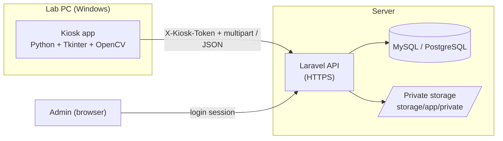

# Library PC Access & Accountability System

🌐 **English** · [Bahasa Indonesia](README.id.md)

A self-service kiosk system for library computer labs. Visitors identify themselves, pass a quick hardware check, and get their photo taken before the PC unlocks. If a keyboard breaks or a mouse goes missing, staff can see **who used that PC last, when, and what they looked like**, without a staff member having to guard the room.

- **Client (kiosk):** Python + Tkinter app running on each lab PC (Windows), packaged as a single `.exe`.
- **Backend:** Laravel REST API + MySQL/PostgreSQL. PCs never touch the database directly.
- **Admin dashboard:** not built yet (the API, database and a protected photo route are ready for it).

---

## Table of contents
1. [How it works](#1-how-it-works)
2. [Architecture](#2-architecture)
3. [Project structure](#3-project-structure)
4. [Database schema](#4-database-schema)
5. [API reference](#5-api-reference)
6. [Setup: backend (Laravel)](#6-setup-backend-laravel)
7. [Setup: kiosk client (Python)](#7-setup-kiosk-client-python)
8. [Build the `.exe`](#8-build-the-exe)
9. [Deploy to lab PCs](#9-deploy-to-lab-pcs)
10. [Configuration reference](#10-configuration-reference)
11. [Security model and limitations](#11-security-model-and-limitations)
12. [Troubleshooting](#12-troubleshooting)
13. [Roadmap](#13-roadmap)

---

## 1. How it works

### Visitor flow (kiosk app)
1. **Standby / lock.** The screen is full-screen and always on top. Windows keys, `Alt+Tab`, `Alt+F4`, `Ctrl+Esc` and `Ctrl+Shift+Esc` are blocked, and Task Manager is disabled via registry.
2. **Identity form.** Name, NPM (5-20 digits), faculty, study program.
3. **Keyboard test.** The visitor types *"Saya bertanggung jawab atas unit ini"* (paste is disabled).
4. **Mouse test.** The visitor clicks a randomly placed target 3 times.
5. **Face capture.** Webcam preview, 3-second countdown, JPEG snapshot.
6. **Session start.** Data and photo are sent to the API in one request. The PC unlocks and a small floating widget (bottom-right) shows the elapsed time and an **End Session** button (click twice to confirm).
7. **Checkout.** The end time is sent to the API and the PC locks again.

If the keyboard or mouse is already broken, the visitor can choose **"report & skip"**. The session is still recorded with `hardware_ok = false`, so staff know the fault existed before that session began.

### Admin flow
1. Log in to the admin area.
2. See each PC's status (`available`, `in_use`, `maintenance`).
3. Filter history by PC or name when a PC is reported broken.
4. Check NPM, session times, hardware test result and the **face photo**.

### Built-in resilience
| Situation | Behavior |
| :--- | :--- |
| PC powers off mid-session | `active_session.json` is kept locally; the session is closed on next boot |
| Network down at checkout | 3 retries; if all fail, the end time is stored locally and re-sent on next boot |
| Stale open session on a PC | Closed automatically when a new session starts on that PC |
| Wrong clock on the PC | Start time uses server time; end time is clamped to server time |
| Kiosk PC not registered | Shows a message with the PC's MAC address and retries every 10 s |
| PC in `maintenance` | Kiosk refuses to start sessions |

---

## 2. Architecture



Key decisions:
- Kiosks **authenticate per PC** with their own token; only the token's SHA-256 hash is stored.
- Photos live on a **private disk**. They are only served through an authenticated admin route.
- PC status (`in_use` / `available`) is maintained by the API inside database transactions.

---

## 3. Project structure

```
library-kiosk/
├── main.py                     # Kiosk client
├── requirements.txt            # Client dependencies
├── .env.example                # Client config template
├── laravel-backend/            # Files to copy into a fresh Laravel project
│   ├── SETUP.md                # Backend-only setup notes
│   ├── routes/api.php
│   ├── database/migrations/
│   │   ├── 2026_10_01_000001_create_computers_table.php
│   │   └── 2026_10_01_000002_create_lab_sessions_table.php
│   └── app/
│       ├── Models/{Computer,LabSession}.php
│       ├── Http/Middleware/AuthenticateKiosk.php
│       ├── Http/Controllers/{KioskController,SessionPhotoController}.php
│       └── Console/Commands/RegisterKiosk.php
└── legacy-supabase/            # Old Supabase SQL (not used anymore)
```

---

## 4. Database schema

**`computers`**

| Column | Type | Notes |
| :--- | :--- | :--- |
| `id` | bigint PK | |
| `pc_name` | string, unique | e.g. `PC-01` |
| `mac_address` | string(17), unique | `AA:BB:CC:DD:EE:FF` |
| `status` | string | `available` / `in_use` / `maintenance` |
| `api_token` | char(64), unique, nullable | SHA-256 hash of the kiosk token |
| `created_at`, `updated_at` | timestamps | |

**`lab_sessions`** (named this way because Laravel already ships a `sessions` table for logins)

| Column | Type | Notes |
| :--- | :--- | :--- |
| `id` | bigint PK | |
| `computer_id` | FK → `computers.id` | cascade on delete |
| `nama`, `fakultas`, `prodi` | string | |
| `npm` | string, indexed | |
| `foto_path` | string, nullable | path on the private disk |
| `hardware_ok` | boolean | `true` only if both tests were passed |
| `jam_mulai` | timestamp | session start |
| `jam_selesai` | timestamp, nullable | `NULL` = still running |
| `created_at`, `updated_at` | timestamps | |

Extra index: `(computer_id, jam_mulai)` for fast per-PC history.

---

## 5. API reference

Base URL: `https://<your-server>/api`. All requests need the header `X-Kiosk-Token: <token>` and should send `Accept: application/json`. Rate limit: 120 requests/minute.

### `POST /kiosk/identify`
Checks that the token and the PC's MAC address belong together.

| | |
| :--- | :--- |
| Body (JSON) | `mac_address` |
| `200` | `{ "id": 1, "pc_name": "PC-01", "status": "available" }` |
| `401` | missing / invalid token |
| `403` | MAC does not match the token's PC |

### `POST /sesi/mulai`
Starts a session. `multipart/form-data`.

| Field | Rules |
| :--- | :--- |
| `nama` | required, 3-100 chars |
| `npm` | required, 5-20 digits |
| `fakultas`, `prodi` | required, max 100 chars |
| `hardware_ok` | required, boolean (`1` / `0`) |
| `foto` | required, JPEG, max 2 MB |

Responses: `201 { "session_id": 42 }`, `409` (PC in maintenance), `422` (validation errors), `401`.
Any stale open session on the same PC is closed first.

### `POST /sesi/selesai`
Ends a session. Safe to send more than once (idempotent).

| Field | Rules |
| :--- | :--- |
| `session_id` | required, integer, must belong to the calling PC |
| `jam_selesai` | optional ISO-8601; ignored if in the future or before the start time |

Responses: `200 { "ok": true }`, `404` (not this PC's session), `401`.

### Admin photo route (web, login required)
`GET /admin/sesi/{session}/foto` streams the photo from private storage.

---

## 6. Setup: backend (Laravel)

Requirements: PHP 8.2+, Composer, MySQL 8 or PostgreSQL, Laravel 11/12.

```bash
composer create-project laravel/laravel library-backend
cd library-backend
php artisan install:api
```

1. **Copy files.** Copy everything inside `laravel-backend/` into the project (overwrite `routes/api.php`).
2. **`.env`:**
   ```
   APP_TIMEZONE=Asia/Jakarta
   DB_CONNECTION=mysql          # or pgsql
   DB_HOST=127.0.0.1
   DB_DATABASE=library_kiosk
   DB_USERNAME=...
   DB_PASSWORD=...
   ```
3. **Register the middleware alias** in `bootstrap/app.php`:
   ```php
   ->withMiddleware(function (Middleware $middleware) {
       $middleware->alias([
           'kiosk' => \App\Http\Middleware\AuthenticateKiosk::class,
       ]);
   })
   ```
   (Laravel 10: add it to `$routeMiddleware` in `app/Http/Kernel.php`.)
4. **Add the admin photo route** in `routes/web.php`:
   ```php
   use App\Http\Controllers\SessionPhotoController;

   Route::get('/admin/sesi/{session}/foto', SessionPhotoController::class)
       ->middleware('auth')->name('admin.sesi.foto');
   ```
5. **Admin login.** Install Laravel Breeze (`composer require laravel/breeze --dev`, then `php artisan breeze:install`) and **disable public registration**. Create admin users manually (e.g. with `php artisan tinker`).
6. **Migrate:**
   ```bash
   php artisan migrate
   ```
7. **Register each PC.** Get the MAC by running `python main.py --mac` on that PC, then:
   ```bash
   php artisan kiosk:register PC-01 AA:BB:CC:DD:EE:01
   ```
   The command prints the `KIOSK_TOKEN` **once**. Put it in that PC's `.env`. Running the command again for the same PC rotates the token.
8. **Serve over HTTPS** (Nginx/Apache + PHP-FPM; Cloudflare in front is fine). Set `upload_max_filesize` and `post_max_size` to at least 4M (and `client_max_body_size 4m;` on Nginx).
9. **Smoke test:**
   ```bash
   curl -H "X-Kiosk-Token: TOKEN" -H "Accept: application/json" \
        -d "mac_address=AA:BB:CC:DD:EE:01" https://your-server/api/kiosk/identify
   ```

---

## 7. Setup: kiosk client (Python)

Requirements: **Windows 10/11**, **Python 3.10-3.12**, a webcam.

```bat
cd library-kiosk
python -m venv venv
venv\Scripts\activate
pip install -r requirements.txt
copy .env.example .env
notepad .env
python main.py --mac      :: shows this PC's MAC address
python main.py            :: starts the kiosk
```

> **Before testing:** set `ADMIN_PIN_SHA256` in `.env`. The only built-in way to leave the kiosk is **`Ctrl+Shift+F12`** + PIN. Without a PIN the kiosk can only be stopped with `taskkill /f /im python.exe` from another machine, or a reboot.

Generate the PIN hash:
```bat
python -c "import hashlib;print(hashlib.sha256(b'YOUR_PIN').hexdigest())"
```

---

## 8. Build the `.exe`

```bat
pip install pyinstaller
pyinstaller --onefile --noconsole --name LibraryKiosk main.py
```

| Flag | Why |
| :--- | :--- |
| `--onefile` | single executable |
| `--noconsole` | no CMD window |
| *(no `--uac-admin`)* | Visitors use a Standard User account, so the exe must not request admin rights (it would show a UAC prompt) |

Output: `dist\LibraryKiosk.exe`. Put the `.env` **in the same folder as the exe** (it is read from disk, not bundled):

```
C:\LibraryKiosk\
    LibraryKiosk.exe
    .env
```

If the build misbehaves: add `--hidden-import cv2`; if antivirus flags the exe (common for apps that hook the keyboard), add an exclusion for the folder.

---

## 9. Deploy to lab PCs

> Deploying to many PCs (e.g. 28)? See [DEPLOY-MASSAL.md](DEPLOY-MASSAL.md) (Indonesian): bulk registration with `php artisan kiosk:import` and an install script.

1. Copy `LibraryKiosk.exe` and a per-PC `.env` (own `KIOSK_TOKEN`, `ADMIN_PIN_SHA256` set) to `C:\LibraryKiosk\`.
2. **Auto-start with Task Scheduler:**
   - *General:* "Run with highest privileges"
   - *Triggers:* "At log on" of the visitor account
   - *Actions:* start `C:\LibraryKiosk\LibraryKiosk.exe`
   - *Settings:* "If the task fails, restart every 1 minute"
3. **Harden Windows** (strongly recommended, see [section 11](#11-security-model-and-limitations)):
   - Use a dedicated **Standard User** account for visitors.
   - Disable Lock / Switch User / Sign out via Group Policy (`gpedit.msc` → *User Configuration → Administrative Templates → System → Ctrl+Alt+Del Options*).
   - Give the visitor account **Read & Execute only** on `C:\LibraryKiosk\`.
   - Set a BIOS password and disable USB boot.
4. Add `.env` and `active_session.json` to `.gitignore` if the client is in version control:
   ```
   .env
   active_session.json
   venv/
   dist/
   build/
   __pycache__/
   ```

---

## 10. Configuration reference

**Client `.env`**

| Variable | Required | Description |
| :--- | :---: | :--- |
| `KIOSK_API_URL` | yes | Backend base URL, e.g. `https://server-lab.kampus.ac.id` (use HTTPS) |
| `KIOSK_TOKEN` | yes | Per-PC token printed by `php artisan kiosk:register` |
| `CAMERA_INDEX` | no | Webcam index, default `0` |
| `ADMIN_PIN_SHA256` | recommended | SHA-256 hash of the admin exit PIN |

**Command-line flags:** `--mac` shows this PC's MAC address in a dialog and exits.

**Local state file:** `%LOCALAPPDATA%\LibraryKiosk\active_session.json` (only while a session is active or an end-time is pending upload).

---

## 11. Security model and limitations

**What is protected**
- PCs have no database credentials. They can only call three API endpoints.
- Each PC has its own revocable token; a token can only close that PC's own sessions, and only works with the registered MAC.
- Photos are not publicly accessible; only logged-in admins can view them.

**Known limitations (be aware)**
- `Ctrl+Alt+Del` **cannot** be blocked by any user-mode app. Use the Windows hardening steps in section 9.
- The client `.env` can be read by anyone with file access. The token only permits kiosk actions, but keep the folder read-only for visitors. The PIN is stored as an unsalted hash, so choose a long PIN.
- The MAC address is checked, but it can be spoofed by someone with admin rights on the PC, which is another reason to use a Standard User account.
- Face photos and student IDs are **personal data**. Post a notice in the lab, decide on a retention period (e.g. delete photos after N months), and check the applicable personal-data law (for Indonesia, UU PDP).

---

## 12. Troubleshooting

| Symptom | Cause / fix |
| :--- | :--- |
| Screen says **"PC ini belum terdaftar"** | Token is valid but MAC differs. Register the MAC shown on screen. On PCs with several network adapters, use the MAC reported by `main.py --mac`, which is what the app sends |
| **"Tidak dapat terhubung ke server"** | Check `KIOSK_API_URL`, HTTPS certificate, firewall, DNS. The app retries every 10 s |
| `401 Token kiosk tidak valid` | Wrong/rotated `KIOSK_TOKEN`; re-run `kiosk:register` and update `.env` |
| `422` messages on the error screen | Validation failed server-side (e.g. NPM not 5-20 digits, photo > 2 MB) |
| `413 Request Entity Too Large` | Raise `client_max_body_size` (Nginx) / `post_max_size` and `upload_max_filesize` (PHP) |
| "Kamera tidak terdeteksi" | Try `CAMERA_INDEX=1` or `2`; check Windows camera privacy settings and that no other app holds the camera |
| Hotkeys not blocked | Run the exe as Administrator (`--uac-admin` / Task Scheduler "highest privileges") |
| Task Manager still disabled after a crash | Delete `DisableTaskMgr` under `HKCU\Software\Microsoft\Windows\CurrentVersion\Policies\System`, or start and exit the kiosk normally |
| Session time off by hours | Set `APP_TIMEZONE` in the Laravel `.env` (e.g. `Asia/Jakarta`) |

---

## 13. Roadmap
- [ ] Admin dashboard: PC status board, history filters by PC/name/NPM, photo viewer
- [ ] Live PC status via Laravel Reverb (WebSocket) or Livewire `wire:poll`
- [ ] Mark a PC as `maintenance` from the dashboard
- [ ] Automatic photo retention / cleanup job
- [ ] Face-presence check before accepting the photo
- [ ] Optional session time limit per visitor
